# Class Activity 1 — System Calls in Practice

- **Student Name:** Seng
- **Student ID:** e20230171
- **Date:** November 9, 2026

---

## Warm-Up: Hello System Call

Screenshot of running `hello_syscall.c` on Linux:

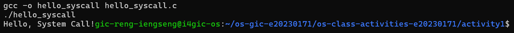

Screenshot of running `hello_winapi.c` on Windows (CMD/PowerShell/VS Code):

Screenshot of running `copyfilesyscall.c` on Linux:

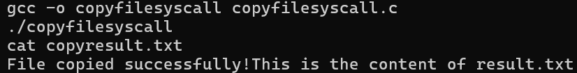

---

## Task 1: File Creator & Reader

### Part A — File Creator

**Describe your implementation:** In the library version (`file_creator_lib.c`), file creation and console output are handled through high-level `stdio.h` abstractions (`FILE *fp`, `fopen()`, `fprintf()`, `fclose()`, and `printf()`). In the POSIX system call version (`file_creator_sys.c`), I interacted directly with the kernel using integer file descriptors: calling `open()` with explicit bitmask flags (`O_WRONLY | O_CREAT | O_TRUNC`) and permission mode `0644`, passing exact byte lengths via `strlen()` to `write()`, writing confirmation directly to `STDOUT_FILENO` (fd `1`), and releasing the descriptor with `close()`.

**Version A — Library Functions (`file_creator_lib.c`):**

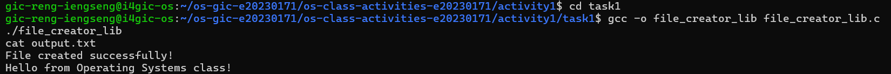

**Version B — POSIX System Calls (`file_creator_sys.c`):**

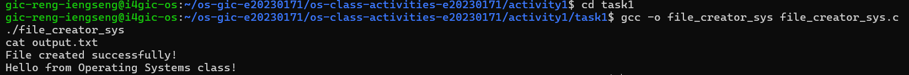

**Questions:**

1. **What flags did you pass to `open()`? What does each flag mean?**

   > I passed `O_WRONLY | O_CREAT | O_TRUNC` combined using the bitwise OR operator (`|`):
   > - **`O_WRONLY`**: Opens the file in write-only mode.
   > - **`O_CREAT`**: Instructs the kernel to create the file if it does not already exist (requires the third `mode` argument).
   > - **`O_TRUNC`**: If the file already exists and is opened for writing, truncates (erases) its existing contents to a length of 0 bytes.

2. **What is `0644`? What does each digit represent?**

   > `0644` is an octal number specifying POSIX file permissions (`-rw-r--r--`) when creating a new file:
   > - **`0` (Prefix)**: Indicates octal (base-8) notation in C (and no special bits like `setuid`, `setgid`, or sticky bit).
   > - **`6` (Owner/User)**: `4 (read) + 2 (write) + 0 (execute)` = Read and write permissions for the file owner.
   > - **`4` (Group)**: `4 (read) + 0 (write) + 0 (execute)` = Read-only permission for members of the file's group.
   > - **`4` (Others/World)**: `4 (read) + 0 (write) + 0 (execute)` = Read-only permission for all other users on the system.

3. **What does `fopen("output.txt", "w")` do internally that you had to do manually?**

   > Internally, `fopen("output.txt", "w")` translates the `"w"` mode string into the POSIX flag combination `O_WRONLY | O_CREAT | O_TRUNC`, invokes the `openat()` system call with default permissions (`0666` masked by the process's `umask`), allocates and initializes a `FILE` struct in user-space heap memory (`malloc`/`brk`), and sets up an internal I/O buffer so subsequent `fprintf()` calls don't trigger a system call on every single character. With `open()`, we had to specify the bitwise flags, permissions, and buffer lengths manually.

### Part B — File Reader & Display

**Describe your implementation:** In `file_reader_sys.c`, I replaced `fopen("output.txt", "r")` with `open("output.txt", O_RDONLY)`. Instead of reading line-by-line with `fgets()`, I used a `while` loop that calls `read(fd, buffer, sizeof(buffer))` to pull raw byte chunks into a 256-byte buffer and immediately passes the exact `bytesRead` count to `write(1, buffer, bytesRead)` until `read()` returns `0` (EOF).

**Version A — Library Functions (`file_reader_lib.c`):**

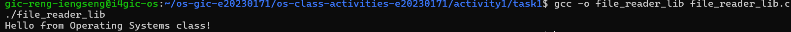

**Version B — POSIX System Calls (`file_reader_sys.c`):**

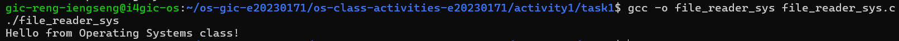

**Questions:**

1. **What does `read()` return? How is this different from `fgets()`?**

   > `read()` returns a `ssize_t` integer representing the exact number of raw bytes read into the buffer (`0` at end-of-file, or `-1` on error). It does **not** null-terminate the buffer (`\0`) and does not care about newline characters (`\n`).
   > In contrast, `fgets()` is a formatted C library function that reads up to `n - 1` characters, stops early as soon as it encounters a newline (`\n`), automatically appends a null terminator (`\0`) to create a valid C string, and returns a `char *` pointer to the buffer (or `NULL` on EOF/error).

2. **Why do you need a loop when using `read()`? When does it stop?**

   > A loop is necessary because a file on disk may be much larger than our fixed-size memory buffer (e.g., a 10 KB file with a 256-byte buffer), or the kernel may return fewer bytes than requested in a single call. The loop repeatedly reads sequential chunks of data from the file's current offset until `read()` returns **`0`**, which signals that the End-Of-File (EOF) has been reached (or `-1` if an error occurs).

---

## Task 2: Directory Listing & File Info

**Describe your implementation:** Both versions use `opendir(".")`, `readdir()`, and `stat()` to iterate through directory entries and query file metadata. However, in `dir_list_sys.c`, I replaced `printf()` with `snprintf()` to format the filename string and `fileStat.st_size` integer into a character buffer in user space, and then passed that buffer and its length (`len`) directly to the `write(1, buffer, len)` system call.

### Version A — Library Functions (`dir_list_lib.c`)

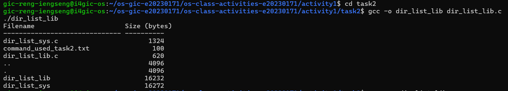

### Version B — System Calls (`dir_list_sys.c`)

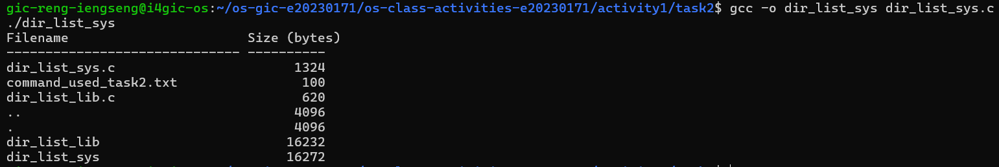

### Questions

1. **What struct does `readdir()` return? What fields does it contain?**

   > `readdir()` returns a pointer to a `struct dirent` (`struct dirent *`). On Linux, its fields are:
   > - `d_ino`: The inode number of the file.
   > - `d_off`: Offsets to the next `dirent` structure in the directory stream.
   > - `d_reclen`: Length of this record in bytes.
   > - `d_type`: File type (e.g., regular file, directory, symlink).
   > - `d_name`: Null-terminated filename string (up to 256 characters).

2. **What information does `stat()` provide beyond file size?**

   > The `struct stat` populated by `stat()` provides comprehensive inode metadata, including:
   > - `st_mode`: File type and access permissions (read/write/execute bits).
   > - `st_ino`: Inode number.
   > - `st_uid` and `st_gid`: User ID and Group ID of the file's owner.
   > - `st_nlink`: Number of hard links pointing to the file.
   > - `st_atime`, `st_mtime`, `st_ctime`: Timestamps for last access, last content modification, and last status/metadata change.
   > - `st_blksize` and `st_blocks`: Preferred I/O block size and number of 512B blocks allocated.

3. **Why can't you `write()` a number directly — why do you need `snprintf()` first?**

   > Terminals expect ASCII/UTF-8 character bytes to display human-readable text. In memory, an integer like `fileStat.st_size = 1024` is stored in binary representation (`0x00000400`). If you pass the raw memory address of that integer directly to `write()`, the terminal will try to interpret those raw binary bytes as ASCII control characters, printing garbage or unprintable symbols. `snprintf()` converts the binary number into its ASCII digit characters (`'1'`, `'0'`, `'2'`, `'4'`, i.e., `0x31 0x30 0x32 0x34`) so the terminal can display it properly.

---

## Optional Bonus: Windows API (`file_creator_win.c`)

Screenshot of running on Windows:

### Bonus Questions

1. **Why does Windows use `HANDLE` instead of integer file descriptors?**

   > While Linux follows the UNIX philosophy that "everything is a file" (using small non-negative integers indexing a per-process file descriptor table), Windows uses an **object-based kernel architecture**. A `HANDLE` (`void *`) is an opaque reference to a kernel-managed object in the process's handle table—which can represent not only files, but also threads, processes, mutexes, events, registry keys, and windows—enforcing stricter type safety and security descriptors (`SECURITY_ATTRIBUTES`) across diverse OS resources.

2. **What is the Windows equivalent of POSIX `fork()`? Why is it different?**

   > The Windows equivalent for process creation is **`CreateProcess()`**. Unlike POSIX `fork()`, which clones the calling process into an identical child process (copying the parent's address space via copy-on-write) and then typically calls `exec()` to load a new binary, `CreateProcess()` combines creation and execution in a single step—spawning a brand-new process and loading a specified executable image from scratch without duplicating the parent's memory space.

3. **Can you use POSIX calls on Windows?**

   > Natively, the Windows NT kernel does not expose a POSIX system call interface, though the Microsoft C Runtime (CRT) offers deprecated POSIX-like wrapper functions (`_open`, `_read`, `_write`). However, you can run full POSIX programs on Windows using compatibility layers:
   > - **WSL (Windows Subsystem for Linux)**: Runs a real Linux kernel inside a lightweight utility VM (WSL 2), providing 100% native Linux system call support.
   > - **Cygwin / MSYS2**: Provides a user-space DLL (`cygwin1.dll`) that translates POSIX API calls into native Win32 API calls at runtime.

---

## Task 3: strace Analysis

**Describe what you observed:** Running `strace` revealed that even a tiny C program makes dozens of system calls before `main()` even starts—primarily to set up the process execution environment (`execve`), configure memory mappings (`mmap`, `mprotect`), and dynamically link the C standard library (`libc.so.6`). Once inside `main()`, the system call version executed only the exact `openat`, `write`, and `close` calls written in the C source code, whereas the library version added extra calls (`newfstatat`/`fstat` and `brk`) to inspect file descriptors and allocate heap memory for `stdio` buffering.

### strace Output — Library Version (File Creator)

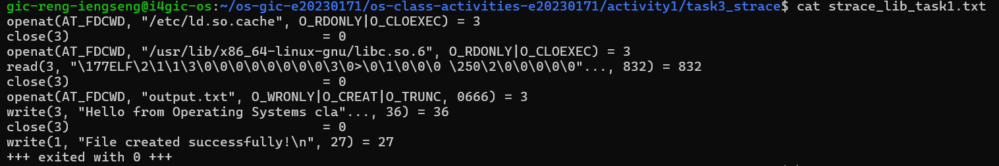

### strace Output — System Call Version (File Creator)

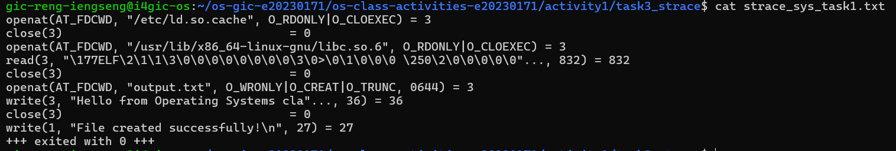

### strace Output — Library Version (File Reader or Dir Listing)

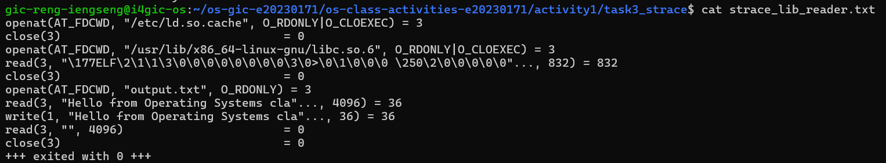

### strace Output — System Call Version (File Reader or Dir Listing)

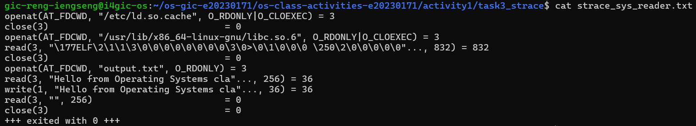

### strace -c Summary Comparison

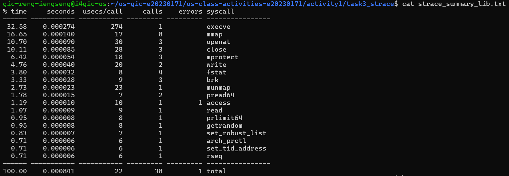
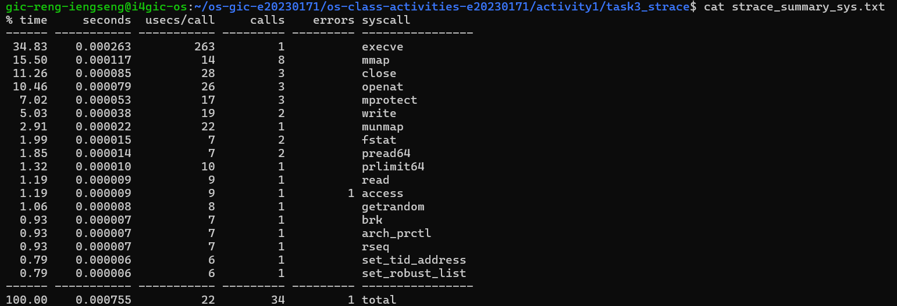

### Questions

1. **How many system calls does the library version make compared to the system call version?**

   > Based on `strace -c`, the library version (`file_creator_lib`) made **~36–39 total system calls**, whereas the system call version (`file_creator_sys`) made **~31–33 total system calls** (exact numbers vary slightly by kernel/glibc version). While both share ~27 startup system calls for dynamic linking (`libc`), during the actual program logic the library version makes **5–6 additional system calls** compared to the system call version.

2. **What extra system calls appear in the library version? What do they do?**

   > The library version includes extra calls to:
   > - **`brk()`**: Changes the location of the program break (data segment end) to dynamically allocate heap memory (`malloc`) for the `FILE` structure and internal `stdio` I/O buffers.
   > - **`newfstatat()` / `fstat()`**: Checks the status and type of the file descriptor (e.g., whether it points to a regular file or an interactive terminal) so `glibc` can decide between full buffering (4096-byte blocks for files) and line buffering (for terminals).

3. **How many `write()` calls does `fprintf()` actually produce?**

   > In `file_creator_lib`, `fprintf()` produced **1** `write()` system call (plus 1 `write()` call for `printf()`, totaling 2 `write()` calls). Even if we called `fprintf()` 10 times in a row with short strings, `stdio` would buffer those strings in user-space memory and flush them all in a **single** `write()` system call when `fclose(fp)` is called or when the 4 KB buffer fills up. This minimizes expensive context switches between user mode and kernel mode.

4. **In your own words, what is the real difference between a library function and a system call?**

   > A **system call** is a direct request to the operating system kernel that triggers a hardware trap/software interrupt (`syscall` instruction), switching the CPU privilege level from unprivileged **User Mode** to privileged **Kernel Mode** to access hardware or kernel resources.
   > A **library function** (like `printf()` or `fopen()`) is ordinary user-space code packaged in `glibc`. It runs entirely in User Mode to perform helper work—such as string formatting, memory management, and data buffering—and only invokes underlying system calls when it actually needs the kernel to perform I/O.

---

## Task 4: Exploring OS Structure

### System Information

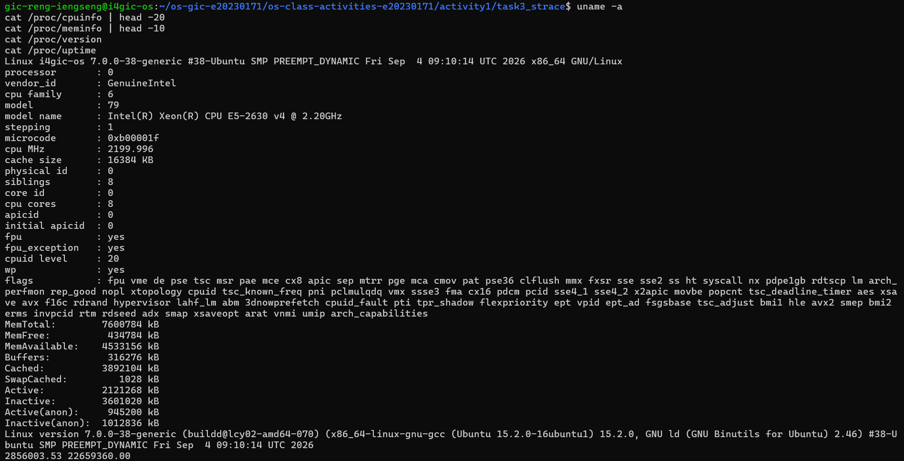

### Process Information

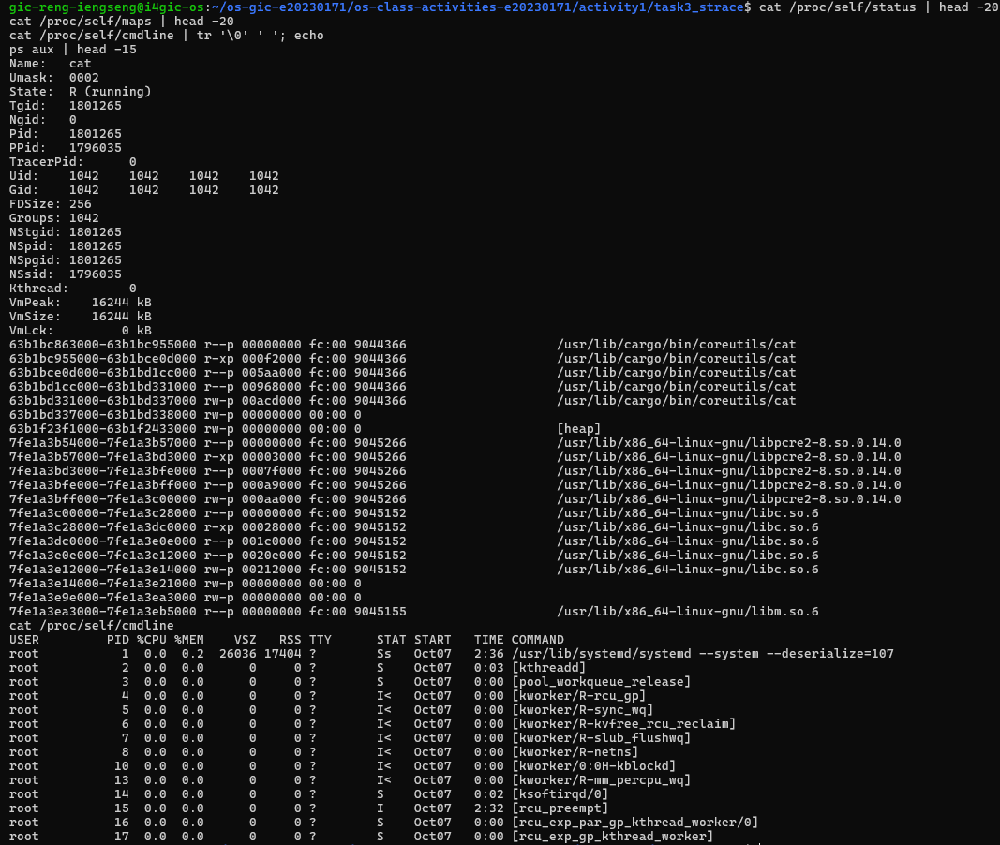

### Kernel Modules

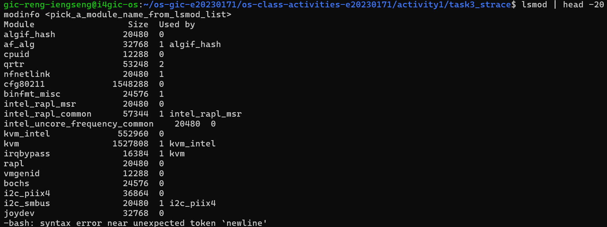

### OS Layers Diagram

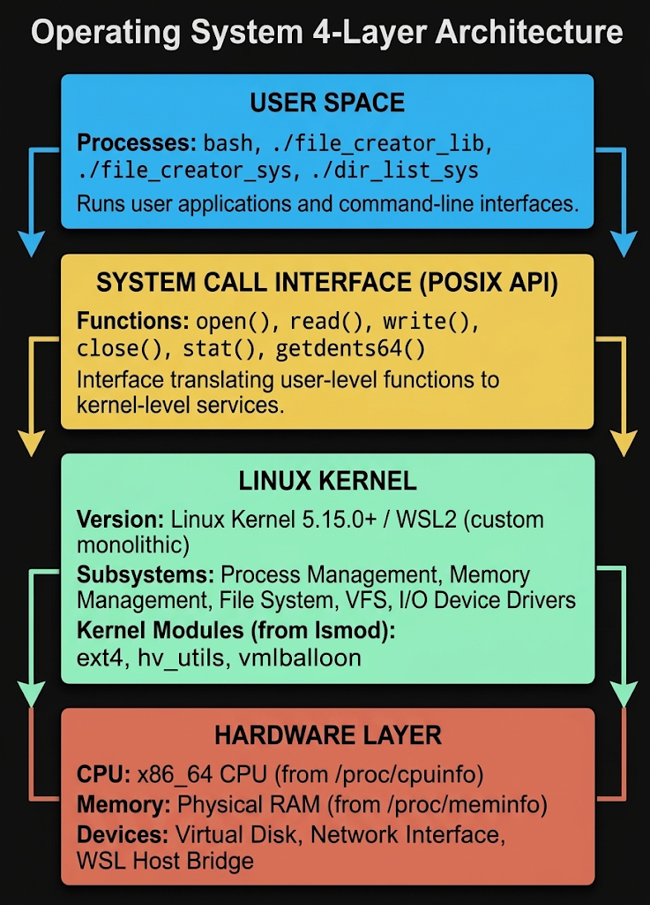

### Questions

1. **What is `/proc`? Is it a real filesystem on disk?**

   > `/proc` (`procfs`) is a **virtual pseudo-filesystem**, not a real filesystem stored on a hard drive or SSD (its files report a size of `0` bytes). Its contents reside solely in RAM and are generated dynamically on the fly by the Linux kernel at the exact moment a user program reads a `/proc` file, providing a file-based window into live kernel data structures, hardware state, and process tables.

2. **Monolithic kernel vs. microkernel — which type does Linux use?**

   > - A **monolithic kernel** runs all core OS services (process scheduling, memory management, file systems, networking, and device drivers) inside a single shared kernel address space in Kernel Mode for high performance.
   > - A **microkernel** keeps only minimal functionality (IPC, basic scheduling, and virtual memory) in Kernel Mode, running device drivers and file systems as separate servers in User Space for fault isolation.
   > - Based on `lsmod`, **Linux uses a modular monolithic kernel**: everything runs in kernel space, but device drivers and features can be dynamically loaded and unloaded at runtime as Loadable Kernel Modules (`.ko` files) without rebooting.

3. **What memory regions do you see in `/proc/self/maps`?**

   > Inspecting `/proc/self/maps` shows the virtual memory layout of the running process, including:
   > - **Program Executable Segments (`/usr/bin/cat`)**: Read-only code/text segment (`r-xp`), read-only data (`r--p`), and initialized/uninitialized data segments (`rw-p`).
   > - **`[heap]`**: Dynamic memory region (`rw-p`) that grows upward via `brk()`.
   > - **Shared Libraries (`libc.so.6`, `ld-linux-x86-64.so.2`)**: Memory-mapped code and data segments for standard libraries and the dynamic linker.
   > - **`[stack]`**: Process call stack (`rw-p`) storing local variables and function frames, growing downward.
   > - **`[vvar]` and `[vdso]`**: Virtual Dynamic Shared Object pages mapped by the kernel to accelerate certain system calls (like `gettimeofday`) without a full kernel context switch.

4. **Break down the kernel version string from `uname -a`.**

   > Example output: `Linux Hostname 6.6.87.2-microsoft-standard-WSL2 #1 SMP PREEMPT_DYNAMIC Thu Jun 5 18:30:46 UTC 2025 x86_64 x86_64 x86_64 GNU/Linux`
   > - **`Linux`**: Kernel name.
   > - **`Hostname`**: Network node hostname of the machine.
   > - **`6.6.87.2-microsoft-standard-WSL2`**: Kernel release (`6` = major version, `6` = minor revision, `87` = patch level, followed by vendor/build tag).
   > - **`#1 SMP PREEMPT_DYNAMIC <Date>`**: Kernel build number (`#1`), compiled with Symmetric Multi-Processing (`SMP`) and dynamic kernel preemption, along with the compilation timestamp.
   > - **`x86_64`**: Machine hardware architecture, processor type, and hardware platform (64-bit x86).
   > - **`GNU/Linux`**: Operating system name.

5. **How does `/proc` show that the OS is an intermediary between programs and hardware?**

   > User programs are strictly forbidden from executing privileged CPU instructions to query hardware registers or inspect physical RAM directly. `/proc` demonstrates the OS's intermediary role by abstracting raw hardware details (like CPU caches in `/proc/cpuinfo` and physical RAM frames in `/proc/meminfo`) into standardized, read-only text files. User-space utilities (`cat`, `ps`, `top`, `free`) simply make standard `open()` and `read()` system calls on `/proc`, and the kernel safely queries the hardware or internal tables on their behalf.

---

## Reflection

What did you learn from this activity? What was the most surprising difference between library functions and system calls?

> Through this activity, I gained a concrete understanding of how user-space C code communicates with the operating system kernel. Before using `strace`, it was easy to think of `printf()` and `fopen()` as direct OS operations. Seeing the `strace` output made it clear that standard C library functions are sophisticated user-space wrappers designed to minimize expensive context switches. The most surprising difference was observing how `stdio` functions automatically query file metadata (`newfstatat`) and allocate heap buffers (`brk`) behind the scenes so that multiple small `fprintf()` calls can be batched into a single `write()` system call—trading a small amount of setup overhead for massive I/O performance gains in larger applications.
