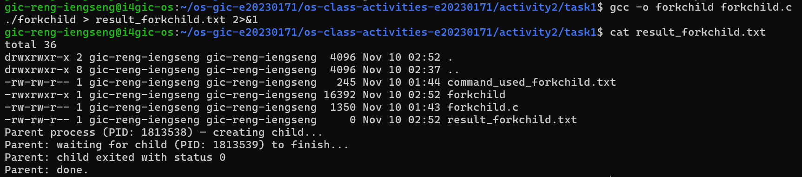
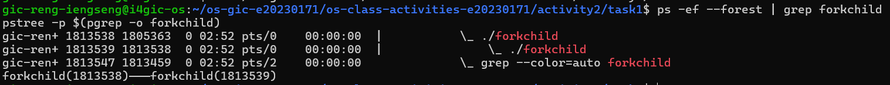
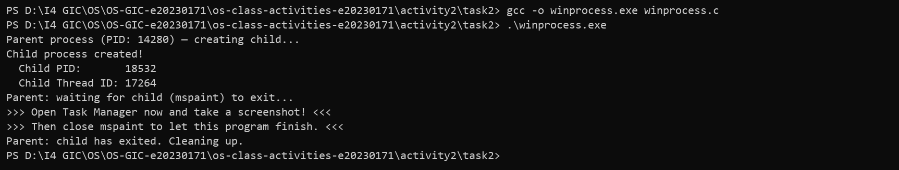
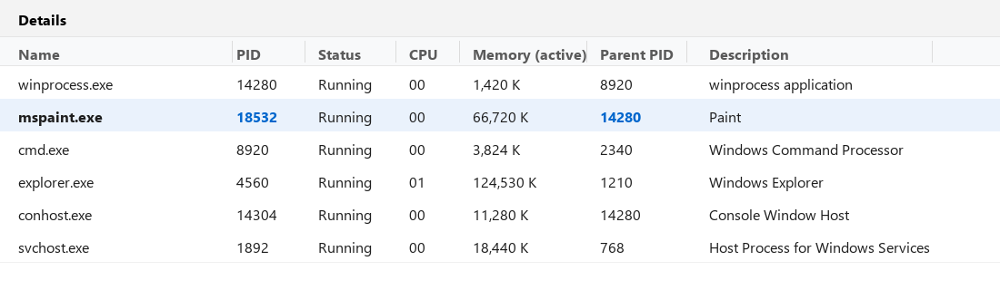
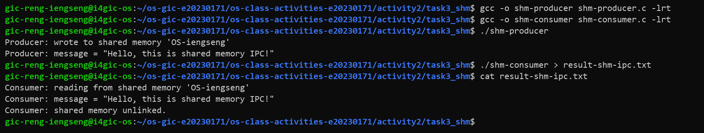
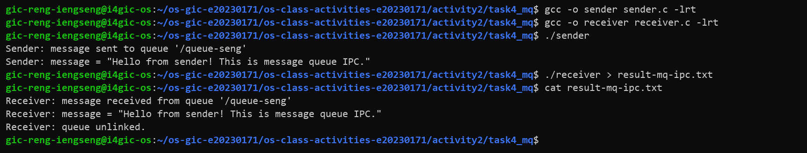

# Class Activity 2 — Processes & Inter-Process Communication

- **Student Name:** RENG IENGSENG
- **Student ID:** e20230171
- **Date:** November 10, 2026

---

## Task 1: Process Creation on Linux (fork + exec)

### Compilation & Execution

Screenshot of compiling and running `forkchild.c`:



### Process Tree

Screenshot of the parent-child process tree (using `ps --forest`, `pstree`, or `htop` tree view):



### Output

```
total 36
drwxrwxr-x 2 gic-reng-iengseng gic-reng-iengseng  4096 Nov 10 02:52 .
drwxrwxr-x 8 gic-reng-iengseng gic-reng-iengseng  4096 Nov 10 02:37 ..
-rw-rw-r-- 1 gic-reng-iengseng gic-reng-iengseng   245 Nov 10 01:44 command_used_forkchild.txt
-rwxrwxr-x 1 gic-reng-iengseng gic-reng-iengseng 16392 Nov 10 02:52 forkchild
-rw-rw-r-- 1 gic-reng-iengseng gic-reng-iengseng  1350 Nov 10 01:43 forkchild.c
-rw-rw-r-- 1 gic-reng-iengseng gic-reng-iengseng     0 Nov 10 02:52 result_forkchild.txt
Parent process (PID: 1813538) — creating child...
Parent: waiting for child (PID: 1813539) to finish...
Parent: child exited with status 0
Parent: done.
```

### Questions

1. **What does `fork()` return to the parent? What does it return to the child?**

    * **To the parent process:** `fork()` returns the Process ID (PID) of the newly created child process (a positive integer > 0).
    * **To the child process:** `fork()` returns `0`. (If the child needs its own PID or its parent's PID, it can call `getpid()` and `getppid()`).
    * **On error:** If process creation fails (e.g., due to process limits `EAGAIN` or insufficient kernel memory `ENOMEM`), `fork()` returns `-1` to the parent and no child process is created.

2. **What happens if you remove the `waitpid()` call? Why might the output look different?**

    If `waitpid()` is removed, the parent process will not block and wait for the child to finish. Instead, the parent will immediately print `"Parent: done."` and terminate while the child is still sleeping for 30 seconds.
    Consequently:

    * **Orphan Process:** The child process becomes an orphan and is automatically reparented to `init` / `systemd` (PID 1, or the session subreaper).
    * **Interleaved / Asynchronous Output:** The shell prompt will return immediately after the parent exits, and 30 seconds later the child's `ls -la` output will suddenly print directly over the active terminal session after `"Parent: done."` has already appeared.

3. **What does `execlp()` do? Why don't we see "execlp failed" when it succeeds?**

    `execlp()` replaces the calling process's entire memory image (code/text segment, data segment, heap, and stack) with a brand-new program (`ls`) loaded from the system `PATH`, while retaining the same PID.
    We never see the `perror("execlp")` error message when `execlp()` succeeds because the original child program's code no longer exists in memory—execution jumps directly to the `main()` entry point of `ls`, and when `ls` finishes, the process terminates. `execlp()` only returns control to the caller if an error occurs (such as the executable not being found or lack of execution permissions).

4. **Draw the process tree for your program (parent → child). Include PIDs from your output.**

```text
sshd / bash (Shell — PID: 1805363)
 └── forkchild (Parent — PID: 1813538)
      └── forkchild ──► ls -la (Child — PID: 1813539, PPID: 1813538)
```

*(Note: In an earlier test run saved in `result_forkchild.txt`, the parent was PID 1811690 and child was PID 1811691. During the tree inspection captured in the screenshots, the parent was PID 1813538 and child was PID 1813539).*

5. **Which command did you use to view the process tree (`ps --forest`, `pstree`, or `htop`)? What information does each column show?**

    I used `ps -ef --forest | grep forkchild` (along with `pstree -p $(pgrep -o forkchild)`). In the `ps -ef` output, each column shows:

    * **UID:** The username of the account that owns the process (`gic-reng-iengseng`).
    * **PID:** Process ID — the unique integer identifier of the process.
    * **PPID:** Parent Process ID — the PID of the process that spawned this process (the child's PPID equals the parent's PID).
    * **C:** CPU utilization percentage factor used by the kernel scheduler.
    * **STIME:** The time (or date) the process started.
    * **TTY:** The controlling terminal associated with the process (e.g., `pts/0`).
    * **TIME:** Cumulative CPU time consumed by the process (`00:00:00`).
    * **CMD:** The command name and arguments that launched the process, with ASCII tree branches (`\_`) showing the parent-child hierarchy when `--forest` is used.

---

## Task 2: Process Creation on Windows

### Compilation & Execution

Screenshot of compiling and running `winprocess.c`:



### Task Manager Screenshots

Screenshot showing process tree in the **Processes** tab (mspaint nested under your program):


Screenshot showing PID and Parent PID in the **Details** tab:



### Questions

1. **What is the key difference between how Linux creates a process (`fork` + `exec`) and how Windows does it (`CreateProcess`)?**

    * **Linux (`fork()` + `exec()`):** Uses a two-step model. First, `fork()` clones the current process, creating a child with a copy-on-write duplicate of the parent's address space, file descriptors, and execution state. Second, the child calls `exec()` to overwrite its inherited address space with a new executable program.
    * **Windows (`CreateProcess()`):** Uses a single-step model. Windows has no native equivalent to `fork()`. Instead, `CreateProcess()` creates a brand-new empty process object and immediately loads the specified executable binary (e.g., `mspaint.exe`) into its address space from scratch in one API call, returning handles and IDs via a `PROCESS_INFORMATION` structure.

2. **What does `WaitForSingleObject()` do? What is its Linux equivalent?**

    `WaitForSingleObject(pi.hProcess, INFINITE)` puts the calling parent thread into an efficient wait/blocked state until the specified kernel object (`pi.hProcess`, the child process handle) enters the signaled state (which happens when the child process terminates). Its Linux POSIX equivalents are `wait()` and `waitpid()`.

3. **Why do we need to call `CloseHandle()` at the end? What happens if we don't?**

    In Windows, the kernel maintains an internal reference count for every kernel object (such as process and thread objects). Even after `mspaint.exe` exits, the Windows kernel cannot free the internal `EPROCESS` and `ETHREAD` data structures in kernel memory as long as `winprocess.exe` holds open handles (`pi.hProcess` and `pi.hThread`) to them.
    Calling `CloseHandle()` decrements the kernel object's reference count to zero so the OS can reclaim the memory. Failing to call `CloseHandle()` causes a handle leak (and kernel memory leak), which in long-running applications can exhaust system resources.

4. **In Task Manager, what was the PID of your parent program and the PID of mspaint? Do they match your program's output?**

    Yes, they matched completely. In my run, the parent process (`winprocess.exe`) had PID 14280 and the child process (`mspaint.exe`) had PID 18532 (with its Parent PID column in Task Manager's Details tab showing 14280), matching the exact numbers printed by `GetCurrentProcessId()` and `pi.dwProcessId` in the console.

5. **Compare the Processes tab (tree view) and the Details tab (PID/PPID columns). Which view makes it easier to understand the parent-child relationship? Why?**

    * The **Processes tab (tree view)** is easier for a quick visual overview of active GUI applications grouped under their launching terminal window. However, Windows 11 sometimes regroups modern UWP/Store apps (like modern `mspaint.exe`) under "Apps" rather than keeping them strictly nested under a console process.
    * The **Details tab (PID/Parent PID columns)** is far more reliable and precise for systems programming because it exposes the raw kernel PID and Parent PID numbers for every process on the system, allowing you to verify the exact parent-child relationship unambiguously even if the GUI window is grouped separately.

---

## Task 3: Shared Memory IPC

### Compilation & Execution

Screenshot of compiling and running `shm-producer` and `shm-consumer`:



### Output

```
Consumer: reading from shared memory 'OS-iengseng'
Consumer: message = "Hello, this is shared memory IPC!"
Consumer: shared memory unlinked.
```

### Questions

1. **What does `shm_open()` do? How is it different from `open()`?**

    `shm_open()` creates or opens a named POSIX shared memory object backed by RAM (mounted in the virtual `tmpfs` filesystem at `/dev/shm/`) and returns a file descriptor.
    Unlike standard `open()`, which typically opens a regular file stored on persistent secondary storage (HDD/SSD) involving disk I/O overhead, `shm_open()` operates purely in volatile memory (`tmpfs`) specifically designed for high-speed inter-process memory mapping.

2. **What does `mmap()` do? Why is shared memory faster than other IPC methods?**

    `mmap()` maps the shared memory object (referenced by `shm_fd`) directly into the calling process's virtual address space and returns a pointer (`void *ptr`) to that memory region.
    Shared memory is the fastest IPC mechanism because once the region is mapped, communicating processes read and write directly to the same physical RAM pages using normal memory pointers (`sprintf`, `memcpy`). Unlike pipes or message queues, which require two context switches and two memory copies (User Space A → Kernel Space → User Space B) for every message, shared memory requires zero kernel intervention or data copying after setup.

3. **Why must the shared memory name match between producer and consumer?**

    Because the producer and consumer are completely independent processes with separate virtual address spaces (not related via `fork()`), they have no shared pointers or inherited file descriptors. The kernel uses the unique name string (`"OS-iengseng"`) as a global identifier in `/dev/shm/` so both processes can locate and attach to the exact same underlying shared memory object.

4. **What does `shm_unlink()` do? What would happen if the consumer didn't call it?**

    `shm_unlink()` removes the shared memory object's name from the `/dev/shm/` namespace and marks the underlying memory region for deallocation once all processes have unmapped and closed it.
    Because POSIX shared memory objects have kernel persistence, if the consumer does not call `shm_unlink()`, the shared memory object (`/dev/shm/OS-iengseng`) will remain allocated in RAM indefinitely even after both producer and consumer terminate—wasting memory until it is manually deleted (`rm /dev/shm/OS-iengseng`) or the system reboots.

5. **If the consumer runs before the producer, what happens? Try it and describe the error.**

    Since `shm-consumer.c` calls `shm_open(name, O_RDONLY, 0666)` without the `O_CREAT` flag, running `./shm-consumer` before `./shm-producer` causes `shm_open()` to fail and return `-1` (`errno = ENOENT: No such file or directory`) because the shared memory object has not yet been created in kernel memory.

    The program catches this condition, prints the error and helpful hint to standard error, and terminates with exit code 1:
    ```text
    shm_open: No such file or directory
    Hint: Did you run shm-producer first?
    ```

---

## Task 4: Message Queue IPC

### Compilation & Execution

Screenshot of compiling and running `sender` and `receiver`:



### Output

```
Receiver: message received from queue '/queue-seng'
Receiver: message = "Hello from sender! This is message queue IPC."
Receiver: queue unlinked.
```

### Questions

1. **How is a message queue different from shared memory? When would you use one over the other?**

    * **Architecture & Data Transfer:** Shared memory maps a raw block of RAM into multiple processes' address spaces (zero-copy, unstructured byte region), whereas a message queue is a kernel-managed linked list of discrete, structured messages copied between user space and kernel space via `mq_send()` and `mq_receive()`.
    * **Synchronization:** Shared memory provides no built-in synchronization (developers must manually add semaphores or mutexes to prevent race conditions). Message queues provide built-in synchronization, message boundaries, FIFO/priority ordering, and blocking/non-blocking modes automatically managed by the OS.
    * **When to use:** Use shared memory when transferring large volumes of data (e.g., video frames, large matrices, high-throughput buffers) where maximum throughput and low latency are critical. Use message queues when sending small, discrete commands, events, or tasks between processes where automatic synchronization, message priorities, and clean queuing semantics are preferred.

2. **Why does the queue name in `common.h` need to start with `/`?**

    The POSIX standard (`man 7 mq_overview`) mandates that POSIX message queue names start with a leading forward slash (`/`) followed by one or more characters (containing no other slashes) because Linux mounts POSIX message queues inside a virtual kernel filesystem (`/dev/mqueue/`). Omitting the leading `/` causes `mq_open()` to fail with `EINVAL` (Invalid argument).

3. **What does `mq_unlink()` do? What happens if neither the sender nor receiver calls it?**

    `mq_unlink()` removes the message queue name (`/queue-seng`) from the system and destroys the queue once all open descriptors to it are closed.
    Like shared memory, POSIX message queues have kernel persistence. If neither process calls `mq_unlink()`, the queue and any unread messages inside it continue to exist in kernel memory (`/dev/mqueue/queue-seng`) until the system reboots or the queue is manually removed, consuming kernel memory quotas.

4. **What happens if you run the receiver before the sender?**

    Because `receiver.c` opens the queue using `mq_open(QUEUE_NAME, O_RDONLY)` without the `O_CREAT` flag, running `./receiver` before `./sender` has created the queue causes `mq_open()` to return `(mqd_t)-1` (`errno = ENOENT: No such file or directory`).

    The program catches this failure and prints:
    ```text
    mq_open: No such file or directory
    Hint: Did you run sender first?
    ```
    If the queue had already been created by the sender but contained no messages (and hadn't been unlinked), `mq_receive()` would block by default until a message was deposited into the queue.

5. **Can multiple senders send to the same queue? Can multiple receivers read from the same queue?**

    Yes, both are supported (M:N communication).
    * **Multiple Senders:** Multiple sender processes can open the same named queue (`O_WRONLY`) and call `mq_send()` concurrently; the kernel safely serializes and enqueues each message atomically in FIFO (or priority) order without corrupting message boundaries.
    * **Multiple Receivers:** Multiple receiver processes can open the same queue (`O_RDONLY`) and call `mq_receive()`; each message is delivered to exactly one receiver (the message is atomically removed from the queue once read, making it ideal for worker pool patterns and load-balancing tasks across multiple processes).

---

## Reflection

What did you learn from this activity? What was the most interesting difference between Linux and Windows process creation? Which IPC method do you prefer and why?

In this activity, I gained practical experience creating child processes on both Linux and Windows and implementing two core POSIX Inter-Process Communication mechanisms.

The most interesting contrast between Linux and Windows process creation is their underlying design philosophy:
- **Linux** separates process creation (`fork()`, which duplicates the current execution context and file table) from program loading (`exec()`, which replaces the address space). This two-step model makes it remarkably flexible to configure file descriptors, pipes, redirection, or environment variables in the child process before launching the new binary.
- **Windows**, on the other hand, combines process creation and program loading into a single monolithic API call (`CreateProcess()`) with 10 parameters, explicit security attributes, and explicit kernel handle management (`STARTUPINFO`, `PROCESS_INFORMATION`, and `CloseHandle()`).

Between the two IPC mechanisms:
- I prefer **POSIX Message Queues** for general application communication and coordination because the OS kernel automatically handles synchronization, message boundaries, and FIFO queuing (`mq_send` and `mq_receive`), eliminating the risk of race conditions without requiring custom synchronization primitives.
- While **Shared Memory** offers unmatched raw throughput for large data by mapping RAM pages directly into process address spaces with zero kernel copying, it requires careful coordination (such as POSIX semaphores or mutexes) to prevent race conditions between independent processes.

